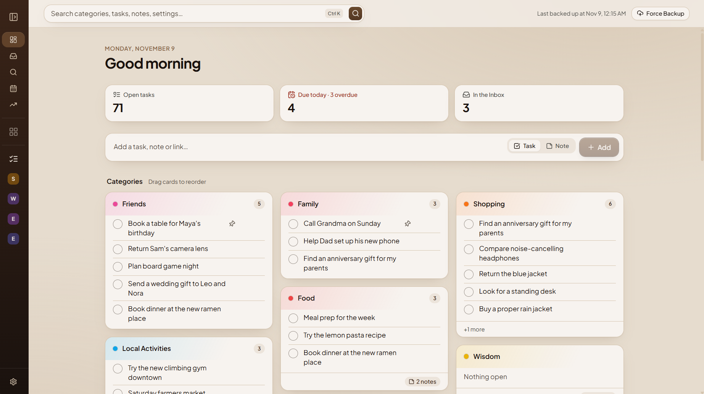
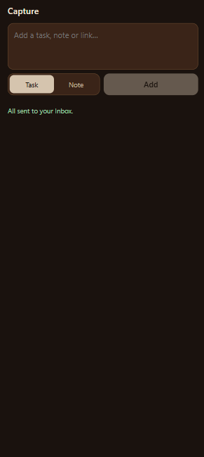
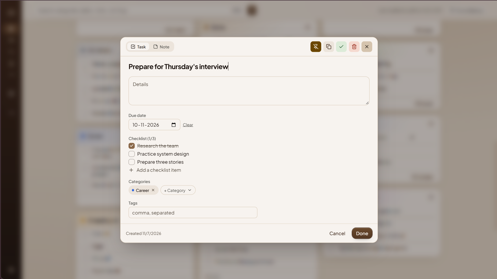
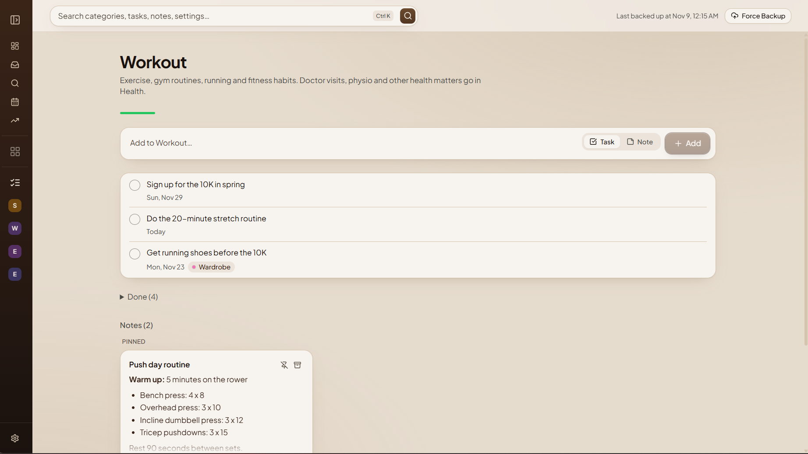
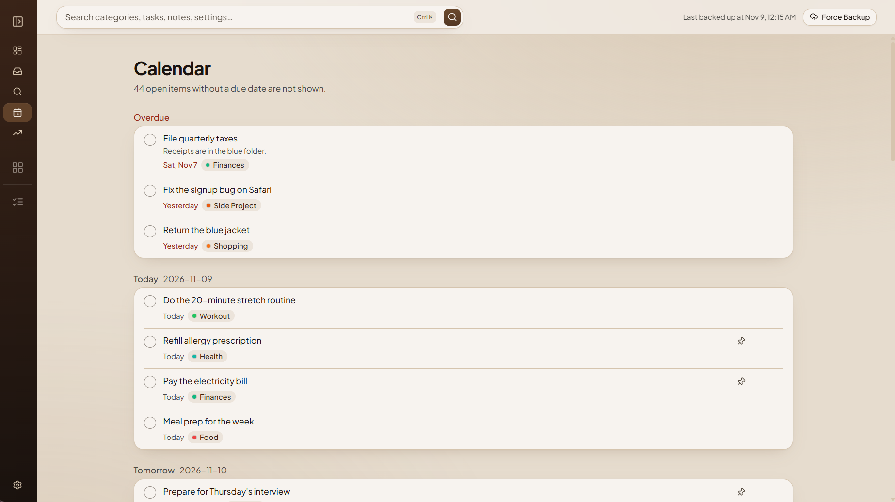
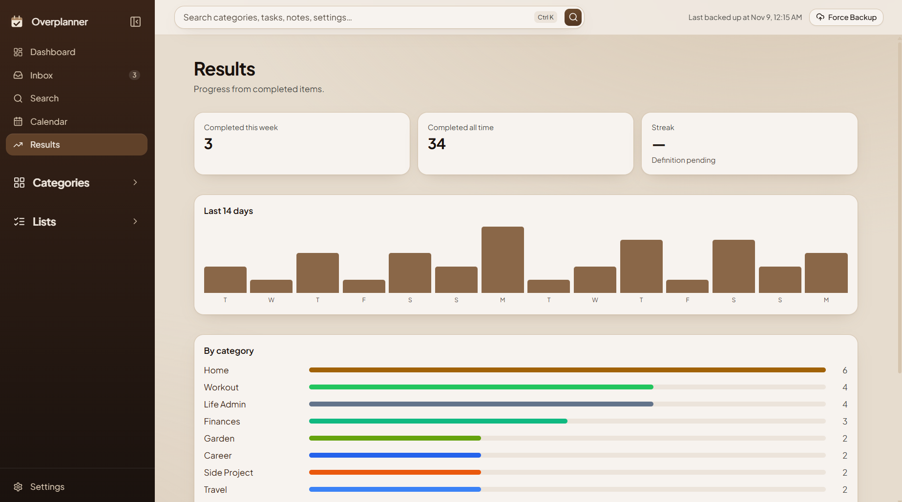
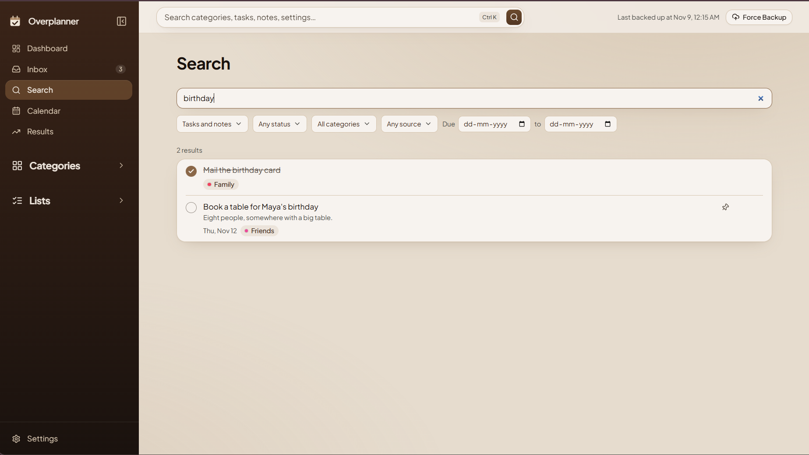
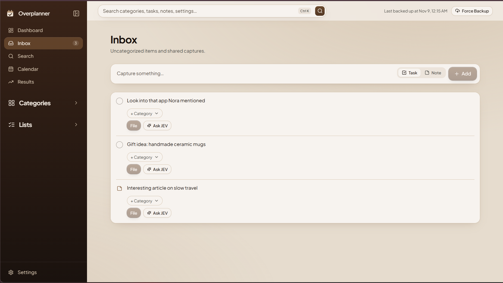
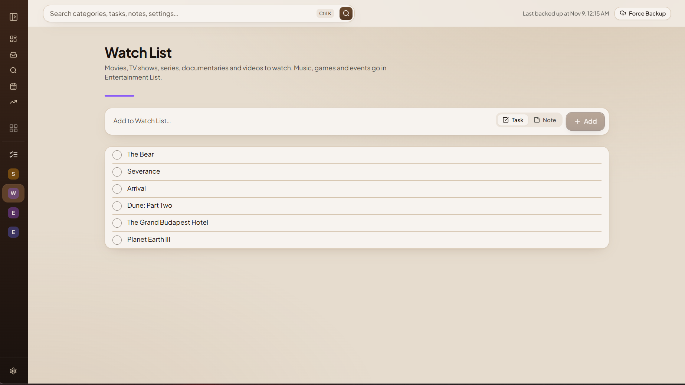
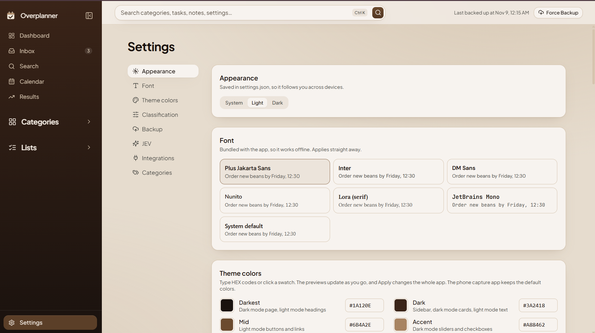

# Overplanner

A self-hosted task and notes app, built as an alternative to Google Keep. It runs on your own computer, keeps your data in plain files, and lets you add to it from your phone.

## Screenshots

### Web app



### Mobile app



<details>
<summary><strong>View more screenshots</strong></summary>

#### Task editor



#### Category page



#### Calendar



#### Results



#### Search



#### Inbox



#### Lists



#### Settings



</details>

## Features

- Tasks, notes, checklists and pins
- Categories and lists, suggested as you type
- A dashboard of cards you can drag to reorder, plus a calendar, progress charts and search across everything
- Light and dark modes, with your own colors and font
- A phone app for quick capture that works offline
- Automatic backups to any folder, including Google Drive
- Import from Google Keep and WhatsApp

## Install

You need [Git](https://git-scm.com/downloads) and [Node.js](https://nodejs.org) 22.12 or newer (20.19 or newer also works).

**1. Download the code**

```bash
git clone https://github.com/Matrix7689/overplanner.git
cd overplanner
```

**2. Install what it needs**

```bash
npm install
```

**3. Build and start it**

```bash
npm run build
npm start
```

**4. Open the app**

Go to [http://localhost:3030](http://localhost:3030). To stop it, press `Ctrl+C` in the terminal.

Your data is saved in a `data/` folder, created the first time it runs. It starts with a standard set of categories, which you can change in **Settings > Categories**.

## Optional setup

### Keep it running (Windows)

This starts Overplanner whenever you sign in to Windows and restarts it if it crashes. Run it once, after `npm run build`:

```bash
powershell -ExecutionPolicy Bypass -File scripts\install-autostart.ps1
```

### Add from your phone

Your phone and computer connect privately through [Tailscale](https://tailscale.com), so nothing is exposed to the internet.

1. Install [Tailscale](https://tailscale.com/download) on both, and sign in to the same account.
2. In the [Tailscale admin console](https://login.tailscale.com/admin/dns), turn on **MagicDNS** and **HTTPS Certificates**.
3. With Overplanner running, run this on your computer:

   ```bash
   tailscale serve --bg 3030
   ```

4. On your phone, open `https://<pc-name>.<tailnet>.ts.net/capture/` in Chrome and choose **Add to Home screen**.

The full app is at the same address without `/capture/`.

### Back up your data

In **Settings > Backup**, choose a folder. A Google Drive for desktop folder also keeps a copy in the cloud.

### Import from Google Keep and WhatsApp

Follow [docs/IMPORTING.md](docs/IMPORTING.md).

### Smarter suggestions

Suggestions use keyword rules out of the box. For AI suggestions from [TypeSafe AI](https://typesafe.ai), copy `.env.example` to `.env`, add your key as `JEV_API_KEY`, and restart. The text you're classifying is then sent to their service.

## Update

Stop the app, then run:

```bash
git pull
npm install
npm run build
npm start
```

## Develop

Stop the app first, because this uses the same port:

```bash
npm run dev
```

Then open [http://localhost:5173](http://localhost:5173).

## Learn more

- [Technical details](docs/DETAILS.md): settings, how classification and backups work, data files and the API
- [Changelog](CHANGELOG.md)
